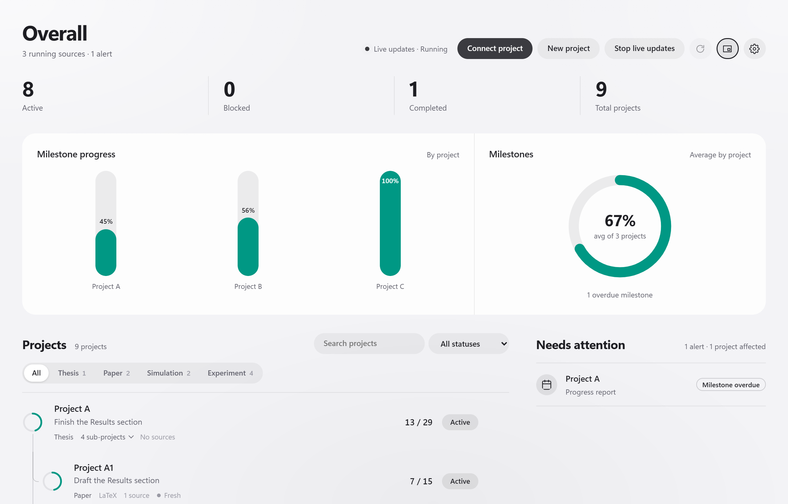
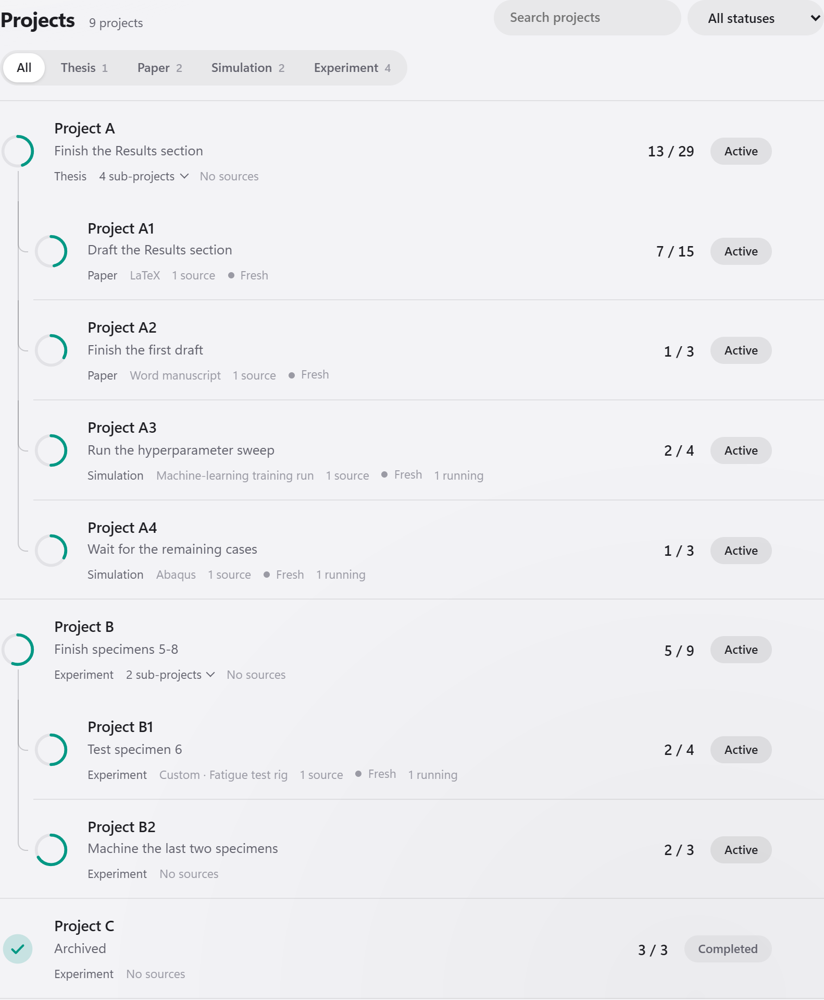
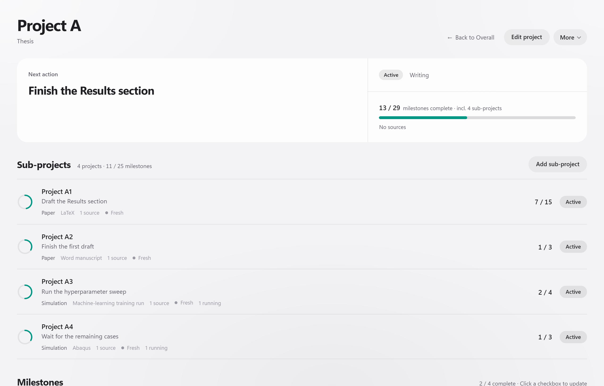
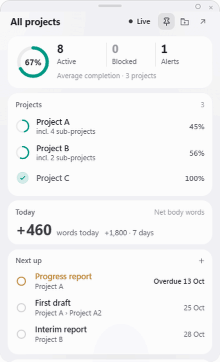
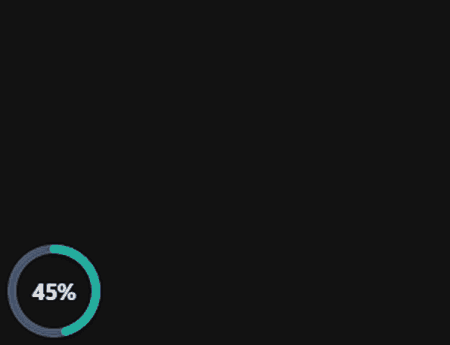
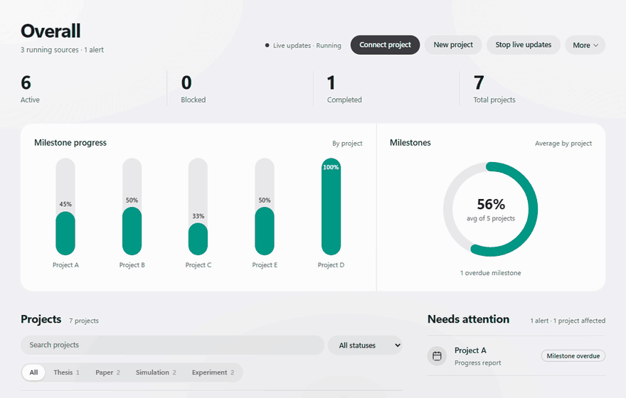
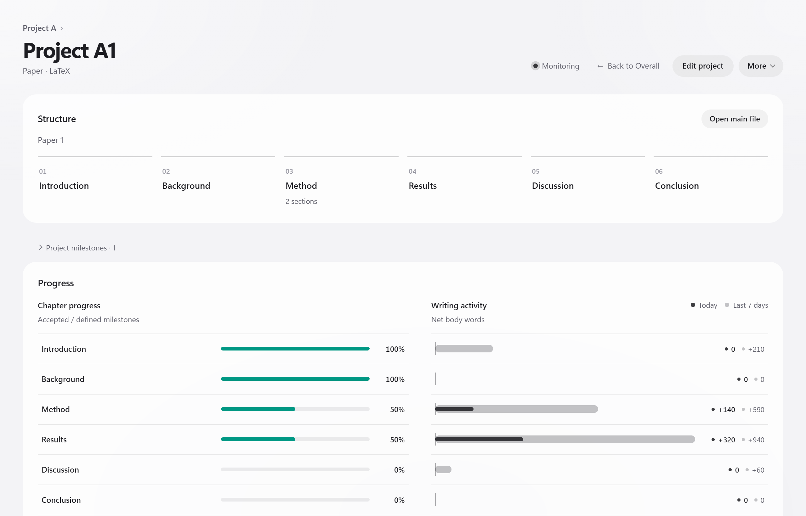
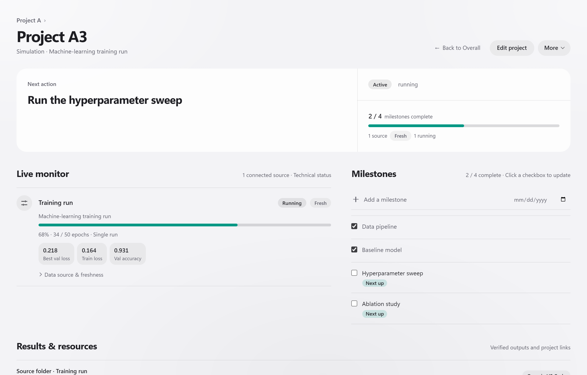
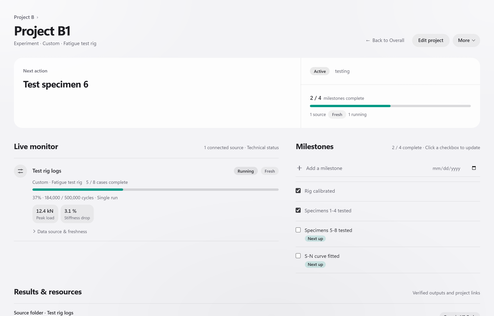

# Monitoring Anything

A desktop app that keeps track of the things you work on: papers, theses, Word manuscripts, simulations,
machine-learning training runs, and anything else that leaves files behind. Connect a folder and it follows the
progress by itself, next to your projects and milestones. A floating widget, or a small circle, keeps the overview on
screen.

Your folders are only read; nothing is compiled, run or modified. Everything the app stores lives in a **workspace**,
an ordinary folder of JSON and Markdown files.

> Status: **0.2.0, early release.** Windows and macOS. Builds are not yet code-signed.



## Projects within projects

Group work the way it actually happens. A top-level project (a thesis, a grant, a test campaign) holds sub-projects,
and **each sub-project can be any kind of work**: a LaTeX paper next to a Word report, a training run, a simulation
batch, a custom-type experiment, or just a list of milestones with no folder at all. The parent's progress counts its
own milestones and every sub-project's, so the thesis ring moves when any paper or run moves.

<p>
  
  &nbsp;
  
</p>

Drop a folder on a project's page to add it as a sub-project, drag a row onto a project to file it there, or give a
project a discovery folder and new subfolders are suggested as sub-projects. The widget can focus one project and
show its sub-projects as columns. (One level deep: a sub-project does not have sub-projects of its own.)

## A widget that stays out of the way

The floating widget keeps projects, today's writing and Next up on screen. Sections grow under the pointer like the
macOS Dock; click a project to focus it (its sub-projects or chapters as columns), the ring or the back arrow to come
back; tick off or add milestones without opening the main window. Idle, it fades into the background.

Shrink it to a **circle** when space is short: just the completion ring, see-through around it. Hovering fans out the
breakdown like a Dock stack; a click opens the widget again, and you can drag the circle anywhere on screen.

<p>
  
  &nbsp;
  
</p>

## Drop a folder to connect it

Drag a folder from Explorer or Finder onto the window (or onto the widget). The app recognises what it is, previews
what it will read from the current files, and waits for you to press Connect. Drop it on a project page and it
becomes a sub-project there.



## What it can follow

Each connected folder gets a **monitoring type**: rules that recognise the folder and say what to read from it. Some
come built in; any other kind of work gets a type of its own. The examples below use made-up projects.

### A thesis written in LaTeX

An umbrella project for the thesis, with each paper as a sub-project. For a LaTeX paper the app reads the section
structure and the words written today and this week, per section. Chapter milestones (draft, complete) are accepted
against the section's current text, and "Next up" puts what you were just writing first. Word manuscripts work the
same way at document level (words, headings, comments, tracked changes).



### A training run

Point it at a run folder with a PyTorch Lightning `metrics.csv` or a Keras `history.csv`: epochs against
`max_epochs`, best validation loss, latest losses and accuracy, and the checkpoints as results. Abaqus jobs (status
logs) and iSALE batches (case metadata) have built-in types too.



### Anything else: your own type

A test rig that writes CSV logs, a solver of your own, a survey that grows a folder of responses: choose **Smart
monitoring** and an agent (Claude Code, Codex, Gemini CLI, Ollama / LM Studio, or an API) designs a type from file
names and short excerpts. Or write it yourself. The plan is validated and previewed against the folder's current files
before anything is connected, and **Save as monitoring type** makes it reusable without an agent. A type is plain JSON
with read-only rules (globs, regexes, CSV and JSON values, log status):

```json
{
  "schemaVersion": "1.0", "id": "fatigue-rig", "title": "Fatigue test rig", "projectType": "experiment",
  "detect": { "allOf": [{ "glob": "rig.json" }], "anyOf": [{ "glob": "logs/*.csv" }] },
  "extract": {
    "runtime": {
      "status": { "fromLog": "logs/*.log", "success": "^Test complete", "failure": "^ABORT", "running": "^Cycle" },
      "currentValue": { "csv": "logs/*.csv", "column": "cycle", "aggregate": "max" },
      "targetValue": { "jsonPath": "rig.json#$.targetCycles" },
      "unit": "cycles"
    },
    "metrics": [{ "id": "peak-load", "label": "Peak load", "unit": "kN",
                  "value": { "csv": "logs/*.csv", "column": "load_kN", "aggregate": "max" } }]
  }
}
```



When rules cannot read a folder (a binary or proprietary format, values computed across files), the agent writes a
**custom adapter**: a short Python function, `collect(folder, options)`, that returns progress, status, cases and
metrics. Ask for it in a chat ("monitor D:\Runs\solver; I need the residual per iteration") or through Smart
monitoring. It is used only if it passes an automatic check (reading modules and calls only; nothing that writes,
starts programs or goes online), and it runs in a separate process that refuses anything but reading inside the folder.
The plan card shows its code; once connected or saved as a type, it runs on every collection with no agent involved.

## Install

Download the installer for your system from [Releases](../../releases) and run it. Python is bundled; nothing else is
needed. For Smart monitoring, have one of the supported agents installed (the first-run guide finds it).

## Use

1. **Create workspace** (any empty folder) on first start.
2. **Connect** a folder you want to follow, or **New project** for an umbrella such as a thesis.
3. Add milestones and tick them off; turn on **Live updates** and keep working as usual.

## Ask your agent

On first start the app installs a skill for the agents it finds (Claude Code, Codex); remove or reinstall it under
Settings → Agent. Then just ask in a chat:

| You ask | The agent |
| --- | --- |
| "How is my thesis going?" | reads the progress: completion, Next up, overdue items, stale sources |
| "Add *Submit to journal* due 10 Nov to Paper 1" | adds the milestone (or completes, renames, re-dates one) |
| "Track the folder `D:\Data\TestRig`" | designs a monitoring type if none fits, then opens the plan card in the app for you to confirm |

Agents work through the `ma` command line the app keeps next to its settings
(`%APPDATA%\io.github.monitoring-anything\ma.cmd` on Windows); they never run or change anything in your folders, and
a new connection always waits for your confirmation. The app never replaces a skill it did not install.

## Development

Needs Node.js 20+, Rust (stable) with the [Tauri prerequisites](https://tauri.app/start/prerequisites/), and
Python 3.10+ for the collector tests.

```bash
npm install
npm run tauri dev       # run with hot reload
npm test                # frontend tests; also npm run test:rust and npm run test:python
npm run tauri build     # installers in src-tauri/target/release/bundle/
```

`src/` is the interface (TypeScript), `src-tauri/` the desktop shell (Rust), `collector/` the Python collector that
reads folders, `skill/` the agent skill. `dev/demo.html` (with `npm run dev`) shows the app with made-up projects;
the screenshots come from it: `npm run demo:media` captures the screenshots and recordings (Chrome, through
playwright-core), `npm run demo:gifs` turns the recordings into GIFs (Python with Pillow), and `npm run demo:connect`
refreshes the plan card's demo data from the collector. Workspace file formats: [`schemas/README.md`](schemas/README.md).

## License

[GNU General Public License v3.0](LICENSE) © 2026 Yang. You may use, study, share and change it; versions you
distribute, changed or not, must stay under the GPL with their source available.
